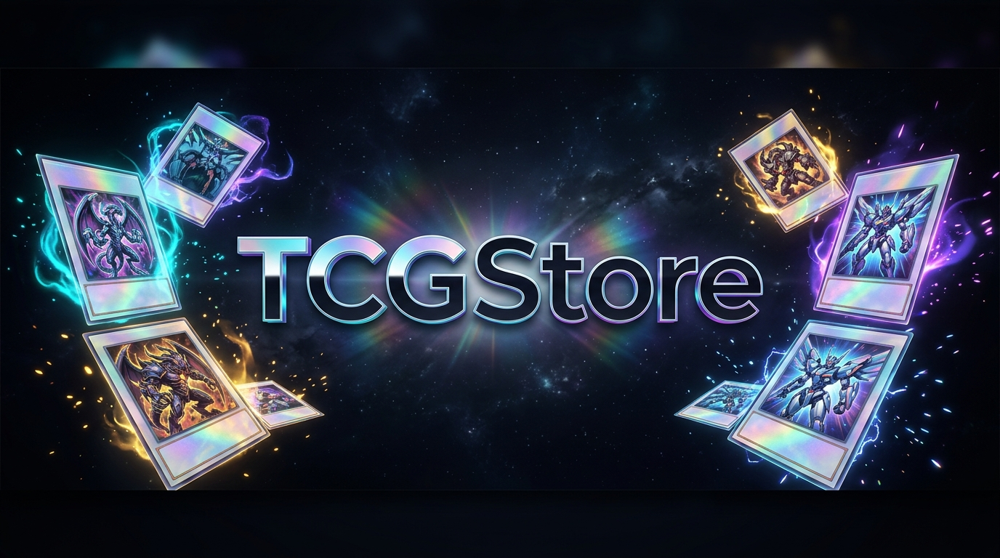

<div align="center">

  
  <p><strong>Plataforma E-commerce Especializada en Trading Card Games (TCG)</strong></p>
  <p>Gestión centralizada de inventario, catálogo interactivo y compra segura de cartas coleccionables y productos sellados.</p>

  <p>
    <code>⚡ Pokémon</code> •
    <code>🔮 Magic: The Gathering</code> •
    <code>🏴‍☠️ One Piece</code> •
    <code>🦖 Digimon</code> •
    <code>🤖 Gundam</code> •
    <code>⚔️ Riftbound</code>
  </p>

  <br />

  <p>
    <a href="https://proyecto-web-y-movil.vercel.app/" target="_blank">
      
    </a>
    <a href="#endpoints-de-la-api-rest">
      
    </a>
    <a href="https://www.figma.com/proto/sfyPtwS7DZlxlQOimMfeaz/TCGStore-Web?node-id=2-3&p=f&t=TFggwOJHHyufxtOT-1&scaling=contain&content-scaling=fixed&page-id=0%3A1&starting-point-node-id=2%3A3" target="_blank">
      
    </a>
    <a href="#requerimientos">
      
    </a>
    <a href="#instalación-y-configuración-local">
      
    </a>
  </p>

  <br />

  <p>
    
    
    
    
    
    
    
    
    
    
  </p>

</div>

---

### Presentado por:
- **Alfonso Durán Araya**
- **Joaquín Alegría Vargas**
- **Martín Albarrán Alcorta**

*Pontificia Universidad Católica de Valparaíso — Escuela de Ingeniería Informática*  
*Asignatura: Ingeniería Web y Móvil (INF3245-1)*

---

## Índice
1. [Acceso a la Plataforma](#-acceso-a-la-plataforma-en-producción)
2. [Cuentas de Demostración](#-cuentas-de-demostración)
3. [Estructura y Gestión de Ramas en GitHub](#-estructura-y-gestión-de-ramas-en-github)
4. [Justificación del Problema](#justificación-del-problema)
5. [Usuarios y Roles del Sistema](#usuarios-objetivo-quién-usará-la-aplicación)
6. [Proto-personas](#proto-personas)
7. [Requerimientos del Sistema](#requerimientos)
8. [Arquitectura de Información y UX](#arquitectura-de-navegación)
9. [Prototipo UI/UX en Figma](#bocetos-uiux)
10. [Stack Tecnológico](#tecnologías-y-herramientas)
11. [Endpoints de la API REST](#endpoints-de-la-api-rest)
12. [Instalación y Configuración Local](#instalación-y-configuración-local)
13. [Pruebas y Testing](#pruebas-y-testing)

---

## 🌐 Acceso a la Plataforma en Producción

La plataforma se encuentra completamente desplegada y accesible en la nube:

* 🚀 **Aplicación Web en Vivo:**  
  👉 [https://proyecto-web-y-movil.vercel.app/](https://proyecto-web-y-movil.vercel.app/)

> [!NOTE]
> La aplicación web se comunica de forma integrada y segura con la API REST y la base de datos PostgreSQL en la nube. No es necesario realizar instalaciones locales para probar el funcionamiento completo del sistema.

### 🔑 Cuentas de Demostración

El esquema de base de datos incluye credenciales precargadas (contraseña universal: `123456`):

| Rol | Correo | Contraseña | Permisos y Acceso |
|---|---|---|---|
| **Administrador** | `admin@tcgstore.com` | `123456` | Acceso exclusivo al Dashboard de gestión (`/admin`, `/admin/inventario`, `/admin/ordenes`), métricas en vivo, semáforo de stock, edición de precios y cambio de estado de pedidos. Bloquea vistas de cliente. |
| **Cliente** | `cliente@tcgstore.com` | `123456` | Navegación de catálogo, carrito de compras persistente, flujo de checkout (`/checkout`) y visualización de historial de compras en Mi Cuenta (`/perfil`). |

---

## 🌿 Estructura y Gestión de Ramas en GitHub

Cumpliendo con la sección **3.2 (Uso y contenido de las ramas)** de la pauta de evaluación:

* **`main`:** Rama de producción oficial. Contiene la versión estable, optimizada y conectada a la nube, desplegada automáticamente en Vercel.
* **`backend`:** Rama de desarrollo del servidor y la base de datos. Contiene la API REST modular en Express, el esquema relacional reproducible [`database/esquema.sql`](database/esquema.sql), pruebas en Postman y la integración completa del sistema.
* **`frontend`:** Rama dedicada a la interfaz de usuario en Ionic y React. Contiene las vistas, componentes, estilos, navegación móvil/escritorio y pruebas unitarias de frontend.

---

## Justificación del problema

En el mercado local de juegos de cartas coleccionables (TCG como Pokémon, Yu-Gi-Oh!, Magic: The Gathering, One Piece, etc.), los jugadores y coleccionistas enfrentan dificultades para encontrar un inventario centralizado y confiable de cartas sueltas ("singles") y productos sellados.

A menudo, las transacciones se realizan a través de redes sociales sin garantías de seguridad, o en tiendas físicas que carecen de un catálogo digital actualizado. Esto obliga al usuario a cotizar presencialmente o a lidiar con múltiples vendedores dispersos, lo que dificulta la selección de los productos adecuados y la comparación de precios.

Además, los sistemas de comercio electrónico tradicionales no están diseñados para manejar los atributos específicos y vitales de una carta coleccionable, tales como la edición, rareza, condición (Near Mint, Lightly Played, Moderately Played), si es "Foil" o el juego al que pertenece.

En este contexto, el problema abordado por el proyecto corresponde a la necesidad de **gestionar, organizar y comercializar artículos de TCG mediante una plataforma optimizada que entienda las particularidades de estos productos**.

Por lo tanto, el desarrollo de una plataforma web y móvil permite centralizar el inventario de la tienda, facilitar la búsqueda estructurada para los clientes desde diferentes dispositivos y proporcionar herramientas de gestión especializadas para los administradores del negocio.

---

## Usuarios objetivo (Quién usará la aplicación)

La aplicación considera principalmente dos grupos de usuarios: **clientes (jugadores/coleccionistas) y administradores**.

### Clientes
Corresponden a los principales usuarios de la plataforma. Son un grupo diverso compuesto tanto por jugadores competitivos como por coleccionistas, cada uno con necesidades de compra distintas.

Dentro de este grupo existen usuarios que:
- buscan una carta muy específica para completar una estrategia de juego;
- buscan cartas antiguas o raras en perfecto estado de conservación;
- desean comprar accesorios (protectores, carpetas, deck boxes) o productos sellados;
- compran desde sus dispositivos móviles mientras están en un torneo;
- necesitan conocer la condición física exacta y el stock en tiempo real antes de pagar.

#### Necesidades principales
- encontrar cartas rápidamente usando filtros avanzados (juego, edición, color, costo, tipo, rareza);
- conocer el estado real de la carta y el stock exacto antes de comprar;
- un proceso de compra rápido (checkout) y seguro;
- disponer de un historial de compras accesible desde su perfil;
- acceso a la tienda desde el móvil de forma fluida.

### Administradores
Constituyen el segundo grupo de usuarios del sistema. Su función principal es administrar la tienda física y su reflejo digital en la plataforma. A diferencia del cliente, el administrador tiene acceso exclusivo a funcionalidades de back-office.

---

## Roles del Sistema

- **Cliente**: Usuario registrado que puede navegar, buscar productos, agregar al carrito y realizar compras.
- **Administrador**: Usuario encargado de gestionar el inventario, los precios y procesar las órdenes de los clientes.

### Definición de conceptos
- **Rol**: Define qué puede hacer un usuario dentro del sistema mediante permisos y rutas protegidas.
- **Proto-persona**: Describe quién podría ser ese usuario, sus características, necesidades, objetivos, dificultades y contexto de uso.

---

## Proto-personas

Las siguientes proto-personas corresponden a **perfiles hipotéticos** construidos a partir del análisis del problema y de las características esperadas de los usuarios de la plataforma.

---

### Proto-persona 1: Jugador Competitivo
* **Nombre ficticio:** Martín
* **Tipo de usuario o rol:** Cliente

#### Características generales
Martín es un joven universitario de 22 años que asiste semanalmente a torneos locales de TCG. Conoce muy bien las reglas de su juego y sabe exactamente qué cartas necesita para mejorar su mazo. Utiliza principalmente su teléfono móvil.

#### Necesidades principales
- Búsqueda rápida y precisa de cartas individuales.
- Conocer la disponibilidad real de stock.
- Proceso de pago ágil y confirmación inmediata.
- Filtrado por atributos específicos del juego.

#### Objetivos de uso
Comprar cartas sueltas ("singles") rápidamente el día jueves para que alcancen a llegar antes de su torneo del fin de semana, o para retirarlas en la tienda física.

#### Dificultades o puntos de frustración
Puede presentar dificultades cuando:
- el buscador de una tienda no le permite filtrar por la edición exacta de la carta;
- llega a la tienda y la carta que aparecía en la web ya se había vendido;
- el proceso de pago es engorroso o falla desde el móvil.

#### Funcionalidades de la aplicación que utilizaría
- Buscador avanzado y filtros especializados en tiempo real.
- Visualización de detalles de la carta (condición, rareza, imagen de alta resolución).
- Carrito de compras reactivo.
- Historial de pedidos con desglose de ítems y estado de entrega.

#### Dispositivo y contexto probable de acceso
Utilizaría principalmente un **teléfono móvil**. Podría acceder durante traslados en transporte público, o en medio de un torneo mientras revisa estrategias con sus compañeros.

---

### Proto-persona 2: Administrador de Tienda
* **Nombre ficticio:** Rodrigo
* **Tipo de usuario o rol:** Administrador

#### Características generales
Rodrigo tiene 35 años y es el dueño de una tienda local de juegos de mesa y TCG. Maneja un gran volumen de inventario que cambia a diario debido a las ventas físicas y la compra de cartas a los mismos jugadores. 

#### Necesidades principales
- Crear y modificar productos de manera ágil con atributos específicos de cartas.
- Visualizar métricas del negocio (ventas totales, pedidos, stock crítico).
- Procesar las órdenes web (cambiar estado a "Pagado", "Enviado" o "Entregado").

#### Objetivos de uso
Mantener el stock web sincronizado con su tienda física y gestionar los envíos a los clientes para aumentar sus ventas sin sobreventas accidentales.

#### Dificultades o puntos de frustración
Puede presentar frustración cuando:
- el sistema de inventario genérico no tiene campos para "Juego", "Condición" o "Rareza";
- agregar una nueva carta al sistema requiere demasiados pasos;
- los botones de acción en las tablas son poco claros o confusos.

#### Funcionalidades de la aplicación que utilizaría
- Dashboard con estadísticas y ventas acumuladas.
- Catálogo interactivo con semáforo de stock (Ok, Bajo stock, Agotado).
- Modal de alta y edición con selectores dinámicos y textos guía.
- Gestión de órdenes con badges de colores según estado de despacho.

#### Dispositivo y contexto probable de acceso
Utilizaría principalmente un **computador de escritorio o tablet** desde el mostrador de su tienda física durante su jornada laboral.

---

## Requerimientos

### Requerimientos Funcionales por Rol

| ID | Requerimiento funcional | Rol |
|---|---|---|
| **RF-01** | El sistema deberá permitir al cliente buscar productos utilizando filtros avanzados especializados (categoría, juego, edición, rareza, condición). | Cliente |
| **RF-02** | El sistema deberá mostrar el detalle completo del producto, incluyendo imagen, precio, stock disponible, edición y estado de conservación (Condición). | Cliente |
| **RF-03** | El sistema deberá permitir al cliente agregar, editar cantidades y eliminar productos dentro de un carrito de compras con persistencia local. | Cliente |
| **RF-04** | El sistema deberá permitir al cliente finalizar su compra (checkout) validando stock y generando una orden registrada en base de datos. | Cliente |
| **RF-05** | El sistema deberá permitir al cliente consultar su historial de compras en su perfil con desglose de ítems y estado actualizado. | Cliente |
| **RF-06** | El sistema deberá permitir al administrador gestionar el catálogo (crear, modificar y eliminar productos) con validación de datos e integridad referencial. | Administrador |
| **RF-07** | El sistema deberá permitir al administrador consultar todas las órdenes recibidas y actualizar su estado (Pendiente, Pagado, Enviado, Entregado). | Administrador |

### Funcionalidades Transversales
- **FT-01:** El sistema deberá permitir el registro de nuevos usuarios clientes con validación de datos y contraseñas seguras.
- **FT-02:** El sistema deberá permitir iniciar sesión mediante JWT (JSON Web Tokens) almacenado en `sessionStorage` para seguridad de sesión.
- **FT-03:** El sistema deberá permitir cerrar la sesión activa eliminando de forma inmediata tokens y datos locales.
- **FT-04:** El sistema deberá restringir funcionalidades y vistas de administración a usuarios sin el rol `admin` mediante guards de enrutamiento (`ProtectedRoute`).

---

## Requerimientos No Funcionales

### UX y Usabilidad
- **RNF-UX-01 (Diseño adaptable):** La interfaz deberá adaptarse fluidamente a dispositivos móviles (360px+) y pantallas de escritorio.
- **RNF-UX-02 (Feedback visual):** Al interactuar con el carrito, buscador o formularios, el sistema proveerá respuestas visuales inmediatas y badges de estado coloridos.
- **RNF-UX-03 (Imágenes claras):** Las miniaturas de cartas cuentan con contenedores enmarcados con respaldo visual (*fallback*) si la imagen falla al cargar.

### Seguridad
- **RNF-SEG-01 (Cifrado de contraseñas):** Las contraseñas se almacenan mediante hash seguro con **bcrypt** (10 rondas de salting).
- **RNF-SEG-02 (Autorización por roles):** Rutas de API protegidas mediante middleware de verificación de JWT y control de rol (`requireRole('admin')`).
- **RNF-SEG-03 (Protección contra inyección SQL y XSS):** Consultas 100% parametrizadas (`$1, $2`) en PostgreSQL sin concatenación directa de cadenas.
- **RNF-SEG-04 (Cabeceras y Rate Limiting):** Implementación de **Helmet** para cabeceras HTTP seguras y **express-rate-limit** para mitigar ataques de fuerza bruta.

### Rendimiento
- **RNF-REN-01 (Carga eficiente):** Carga perezosa (*lazy loading*) de rutas e imágenes de cartas para mantener un inicio rápido de la aplicación.
- **RNF-REN-02 (Búsqueda en vivo):** Filtrado reactivo en el frontend para respuesta instantánea en catálogos extensos.

---

## Arquitectura de Navegación

### 1. Rutas principales y secundarias

#### Rutas públicas
| Ruta | Vista | Descripción |
|---|---|---|
| `/` o `/home` | Home | Banners de colecciones, productos destacados y accesos a categorías. |
| `/catalogo` | Catálogo | Catálogo completo con buscador y filtros por juego, categoría y condición. |
| `/producto/:id` | Detalle | Ficha técnica de la carta, atributos de TCG y botón de compra. |
| `/login` | Iniciar Sesión | Formulario de autenticación con feedback de errores y redirección contextual. |
| `/registro` | Registro | Formulario de alta para nuevos clientes con validaciones de contraseña. |

#### Rutas protegidas del Cliente
| Ruta | Vista | Acceso | Descripción |
|---|---|---|---|
| `/carrito` | Carrito | Cliente | Visualización de ítems seleccionados, control de cantidades y totales calculados. |
| `/checkout` | Checkout | Cliente | Formulario de despacho, método de pago y confirmación de orden con stock en tiempo real. |
| `/perfil` | Mi Cuenta | Cliente / Admin | Historial de órdenes con fechas, totales y estado de despacho. |

#### Rutas protegidas del Administrador
| Ruta | Vista | Acceso | Descripción |
|---|---|---|---|
| `/admin` | Resumen | Solo Admin | Métricas globales de la tienda (Ventas, Pedidos, Stock total, Clientes) y órdenes recientes. |
| `/admin/inventario` | Catálogo | Solo Admin | Tabla de cartas con buscador en vivo, semáforo de stock, botón de nuevo producto y modal con selectores guiados. |
| `/admin/ordenes` | Órdenes | Solo Admin | Gestión de pedidos con selector de estado colorizado (Pendiente, Pagado, Enviado, Entregado) y modal de detalle. |

### 2. Estructura Jerárquica de Vistas

```text
TCGStore
│
├── Rutas Públicas
│   ├── Home (Banners, Novedades)
│   ├── Catálogo (Buscador, Filtros por Juego)
│   │   └── Detalle de Producto
│   ├── Iniciar Sesión (/login)
│   └── Registro (/registro)
│
└── Rutas Protegidas (ProtectedRoute)
    │
    ├── Cliente (Rol 'client')
    │   ├── Carrito (/carrito)
    │   ├── Checkout (/checkout)
    │   └── Mi Cuenta / Historial (/perfil)
    │
    └── Administrador (Rol 'admin')
        ├── Dashboard / Resumen (/admin)
        ├── Inventario y Catálogo (/admin/inventario)
        └── Gestión de Órdenes (/admin/ordenes)
```

---

## Diferenciación de acceso según roles

| Funcionalidad | Usuario Anónimo | Cliente | Administrador |
|---|:---:|:---:|:---:|
| Explorar catálogo de cartas | ✓ | ✓ | ✓ |
| Ver detalles de la carta | ✓ | ✓ | ✓ |
| Agregar productos al carrito | ✓ | ✓ | — |
| Finalizar compra (Checkout) | Inicia sesión | ✓ | — |
| Ver historial de órdenes propio | — | ✓ | ✓ |
| Dashboard con métricas globales | — | — | ✓ |
| Crear y modificar productos | — | — | ✓ |
| Cambiar estado de órdenes | — | — | ✓ |

---

## Bocetos UI/UX

El diseño de la interfaz y la experiencia de usuario (Wireframes y Prototipos interactivos) fue elaborado en **Figma**:

- 🎨 **Prototipo Interactivo:** [Ver diseño en Figma](https://www.figma.com/proto/sfyPtwS7DZlxlQOimMfeaz/TCGStore-Web?node-id=2-3&p=f&t=TFggwOJHHyufxtOT-1&scaling=contain&content-scaling=fixed&page-id=0%3A1&starting-point-node-id=2%3A3)
- 📧 **Accesos de evaluación:** Se remitieron invitaciones oficiales a los correos de los profesores evaluadores de la asignatura.

---

## Tecnologías y Herramientas

### Frontend
* **Framework:** Ionic Framework (v8+) con React 19.
* **Lenguaje:** TypeScript 5.
* **Enrutador:** React Router v6 con componentes de redirección y protección por roles.
* **Iconografía:** Ionicons v8.
* **Bundler & Tooling:** Vite 8 con minificación mediante LightningCSS.
* **Testing:** Vitest y React Testing Library (17 pruebas unitarias automatizadas).

### Backend
* **Runtime:** Node.js v20+.
* **Servidor HTTP:** Express.js modular con arquitectura de rutas, controladores y middlewares.
* **Base de Datos:** PostgreSQL con driver `pg` (Pool de conexiones transaccionales).
* **Seguridad:** JSON Web Tokens (`jsonwebtoken`), hashing de contraseñas (`bcryptjs`), `helmet` y `express-rate-limit`.
* **Testing:** Módulo nativo `node:test` y `supertest` (12 pruebas automáticas de endpoints e integración).

### Infraestructura y Nube
* **Cloud Database:** Supabase PostgreSQL con SSL pooler activo.
* **Frontend Hosting:** Vercel con integración continua (CI/CD) desde GitHub.
* **Backend Hosting:** Render Web Service con HTTPS automático y despliegue continuo.

---

## Endpoints de la API REST

Las rutas protegidas requieren el encabezado `Authorization: Bearer <token>` obtenido al iniciar sesión.

| Método | Endpoint | Acceso / Rol | Descripción |
|---|---|---|---|
| **POST** | `/api/auth/register` | Público | Registra una cuenta de cliente con validación de formato y contraseña. |
| **POST** | `/api/auth/login` | Público | Autentica credenciales con bcrypt y retorna el token JWT y datos de usuario. |
| **GET** | `/api/auth/me` | Cliente / Admin | Retorna los datos del perfil del usuario autenticado. |
| **PUT** | `/api/auth/me` | Cliente / Admin | Actualiza los datos de perfil (nombre, teléfono, dirección). |
| **GET** | `/api/categories` | Público | Lista las categorías y franquicias disponibles. |
| **GET** | `/api/products` | Público / Admin | Lista y filtra productos; admin puede incluir productos inactivos. |
| **GET** | `/api/products/:id` | Público / Admin | Retorna el detalle de una carta por ID o código comercial. |
| **POST** | `/api/products` | Admin | Crea una nueva carta o artículo en la base de datos. |
| **PUT** | `/api/products/:id` | Admin | Actualiza los datos (precio, stock, condición, atributos) de un producto. |
| **DELETE** | `/api/products/:id` | Admin | Desactiva o elimina un producto de catálogo. |
| **GET** | `/api/orders` | Cliente / Admin | Lista las órdenes del cliente autenticado o todas las órdenes para admin. |
| **GET** | `/api/orders/:id` | Cliente / Admin | Retorna el desglose de productos y totales de una orden específica. |
| **POST** | `/api/orders` | Cliente | Crea un nuevo pedido con transacción SQL y descuento atómico de stock. |
| **PATCH** | `/api/orders/:id/status` | Admin | Actualiza el estado del pedido (Pendiente, Pagado, Enviado, Entregado). |
| **GET** | `/api/admin/stats` | Admin | Retorna ventas totales, pedidos, stock consolidado y pedidos recientes. |
| **GET** | `/api/health` | Público | Endpoint de verificación de estado y salud del servidor. |

---

## Instalación y Configuración Local

Si deseas ejecutar el proyecto en tu entorno local sin depender de los servicios en la nube:

### 1. Prerrequisitos
* Node.js v18+ (recomendado v20+ o v22+).
* PostgreSQL v14+ instalado localmente (o credenciales de Supabase).

### 2. Base de Datos Local
Crea la base de datos e inicializa las tablas con el script oficial:
```bash
createdb -U postgres tcgstore
psql -U postgres -d tcgstore -f database/esquema.sql
```

### 3. Configuración y Ejecución del Backend
```bash
cd backend
cp .env.example .env
npm install
npm start
```
*El servidor backend iniciará en `http://localhost:3000`.*

### 4. Configuración y Ejecución del Frontend
En otra terminal:
```bash
cd frontend
npm install
npm run dev
```
*Vite abrirá la aplicación en `http://localhost:5173`, conectándose automáticamente a `http://localhost:3000/api`.*

---

## Pruebas y Testing

El proyecto cuenta con un conjunto integral de pruebas automatizadas:

* **Pruebas de Backend:**  
  ```bash
  cd backend && npm test
  ```
  *Ejecuta 12 pruebas automáticas cubriendo autenticación, roles, transacciones de stock, errores SQL y estadísticas de administración.*

* **Pruebas Unitarias de Frontend:**  
  ```bash
  cd frontend && npm run test.unit -- --run
  ```
  *Ejecuta 17 pruebas unitarias verificando enrutamiento protegido, servicios de API, sesión en sessionStorage y componentes.*

* **Compilación de Producción:**  
  ```bash
  cd frontend && npm run build
  ```
  *Verifica la compilación estricta de TypeScript y el empaquetado de producción con Vite.*

* **Colección de Postman:**  
  Ubicada en [`testing/TCGStore_EP2.postman_collection.json`](testing/TCGStore_EP2.postman_collection.json) junto a su entorno [`testing/TCGStore_Local.postman_environment.json`](testing/TCGStore_Local.postman_environment.json), cubriendo todos los endpoints y casos de prueba requeridos por la rúbrica de la Entrega Parcial 2.
